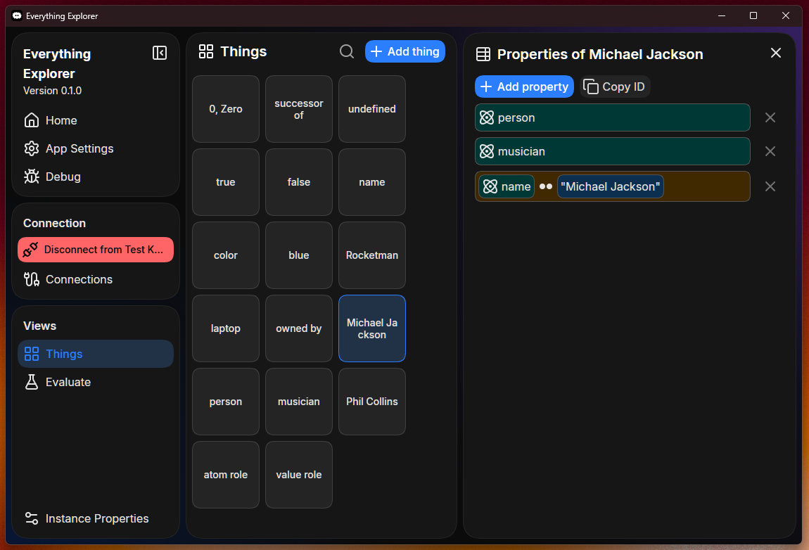

# Everything Explorer



A cross-platform desktop app for browsing and editing
[Everything](https://github.com/Trombecher/everything) knowledge bases.
_Everything_ is a knowledge database built on a reflective object model with a
pure functional computation system, and Everything Explorer gives you a visual
way to work with it.

## Features

- **Things** – browse atoms, search by atom ID, and inspect their properties.
- **Editing** – add, change, and remove statements in the knowledge base.
- **Evaluate** – evaluate objects with the Everything computation system,
  including paged lazy results.
- **Connections** – create or open local knowledge bases, or connect to remote
  knowledge servers over HTTP.
- **Theming & i18n** – light and dark mode with English and German UI.

The application is in early development.

## Getting Started

Prerequisites: `nub`, the Rust toolchain pinned in `rust-toolchain.toml`, and
the [Tauri prerequisites](https://tauri.app/start/prerequisites/) for your OS.

The backend currently uses path dependencies on the
[Everything](https://github.com/Trombecher/everything) repository, so you must
clone its latest version as a sibling directory of this repository
(`../everything`). This will be changed to regular dependencies in the future.

```sh
nub install
nub run tauri dev
```

To run only the frontend in a browser (remote connections only, no local
knowledge bases):

```sh
nub run dev
```

Then open `http://localhost:1420`.

## Architecture

The frontend is a SolidJS single-page app built with Vite and Tailwind CSS. The
Tauri v2 backend embeds an Axum web server that serves local knowledge bases.

All knowledge base traffic goes through the same HTTP API, whether the knowledge
base is local or remote. In the desktop app, the frontend connects to the
embedded local server instead of using Tauri IPC for data. This keeps a single
protocol implementation shared by local and remote usage.

- `src-tauri` – Tauri shell, local knowledge server, and API
- `src/connect` – HTTP client for knowledge servers
- `src/model` – object model and wire encoding
- `src/ui` – SolidJS views and components

## License

This project is [MIT-licensed](./LICENSE).
